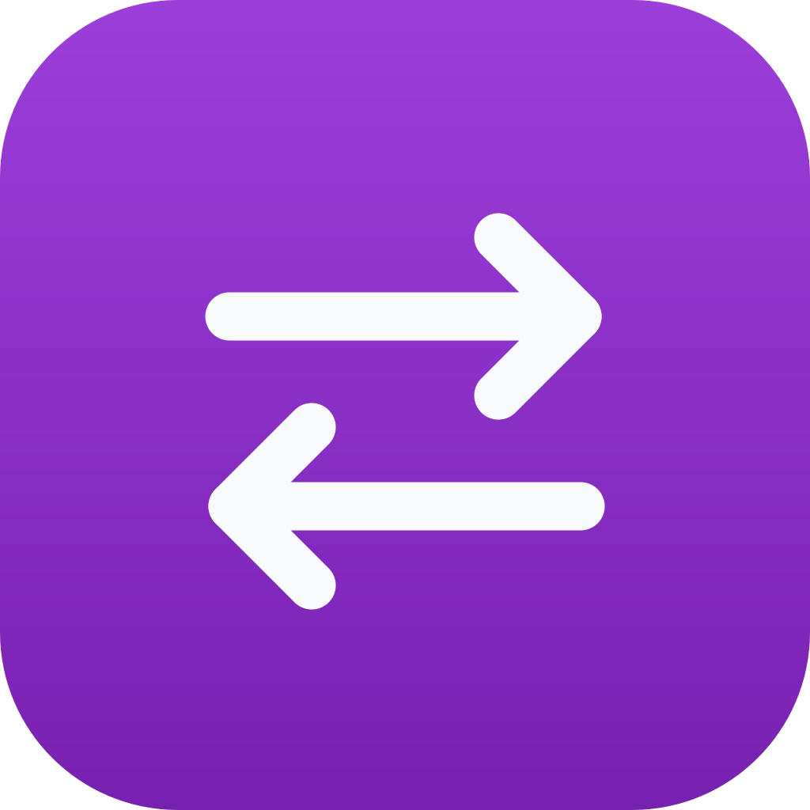
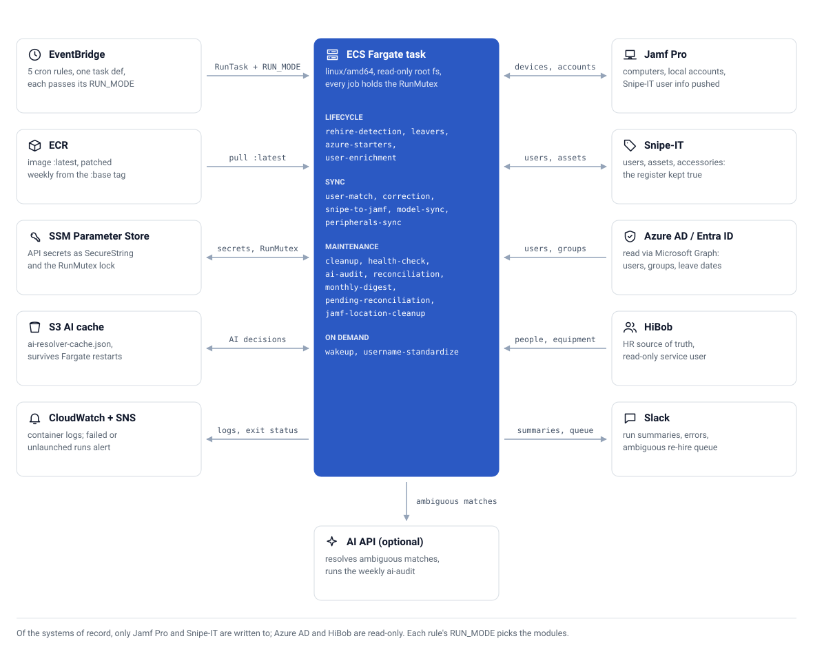

<div align="center">



# 🔄 Jamf-SnipeIT Suite

**Keep your Macs in Jamf Pro and your assets in Snipe-IT matched to the right people on a schedule: starters, leavers and rehires, with a dry run before every change**


[](https://github.com/CaputoDavide93/Jamf-Snipe-IT-Suite/actions/workflows/ci.yml)

</div>

---

## 🎯 Why it exists

People join, leave, change surname, move from contract to permanent, and sometimes come back the day after being offboarded. Each change touches Jamf Pro (devices), Snipe-IT (the asset register), Azure AD (identity) and HiBob (HR). When the four drift apart you get laptops nobody can find, ghost users and wrong audit answers, and the fix is an afternoon of spreadsheets.

Jamf-SnipeIT Suite runs those checks for you. Each job reads the systems, decides what is out of step, and either fixes it or, when a person should decide, posts it to Slack. Every command that changes data has `--dry-run`.

| | Jamf-SnipeIT Suite | Doing it by hand | A one-off script per system |
|---|---|---|---|
| New starters in Snipe-IT | Created from an Azure AD group on a schedule | Typed in | Only if you write the loop |
| Mac to owner | Six matching steps, manual overrides last | Read the local account, search, check out | Usually one exact match |
| Leavers | Tagged `[Disabled]`, assets set to *Pending*, nothing deleted | Easy to forget | Whatever you write |
| Rehires | Restored only when four signals agree, otherwise Slack | Noticed when someone asks | Rarely handled |
| Overlapping runs | A lock in SSM skips the later job | n/a | Not handled by default |
| Preview a change | `--dry-run` on every command that changes data | n/a | Only if you write it |
| HR system | Read-only, never written | n/a | Up to you |

The trade-off: it assumes your stack is exactly Jamf Pro, Snipe-IT, Azure AD and HiBob (the HiBob modules are optional), and the production path assumes AWS. It does not guess about people: ambiguous cases wait in Slack for you.

---

## 🚀 Install in 3 steps

You need Python 3.12 or newer (or Docker), a Jamf Pro account that can read computers, and a Snipe-IT API token.

1. **Get the code.**

   ```bash
   git clone https://github.com/CaputoDavide93/Jamf-Snipe-IT-Suite.git && cd Jamf-Snipe-IT-Suite
   python3 -m venv venv && source venv/bin/activate && pip install -r requirements.txt
   ```

2. **Add credentials.** Copy `config/config.example.yaml` to `config/config.yaml` and fill in the `jamf` and `snipeit` sections. The file is gitignored.

3. **Run the read-only check.** It lists the hardware models Jamf knows and Snipe-IT lacks, and changes nothing.

   ```bash
   python src/main.py model-sync --check-only
   ```

<picture>
  <source media="(prefers-color-scheme: dark)" srcset="docs/assets/screenshots/model-sync-dry-run-dark.png">
  
</picture>

*Output of `python src/main.py model-sync --dry-run` against a local mock with demo data.* Next: [the full setup](docs/setup.md), including Docker and AWS Fargate.

---

## ✨ Features

| | Feature | What you get |
|---|---|---|
| 🤝 | Zero-touch starters | New staff, contractors included, appear in Snipe-IT before their first Monday |
| 🔁 | Rehire detection | Returners are restored with their machine assignment, but only when Azure AD, group membership, leave date and HiBob all agree |
| 🧠 | Layered user matching | Override, exact, email, normalised username, fuzzy score, then an optional external AI service for the hard cases |
| 🚪 | Safe leaver processing | Departed users are tagged `[Disabled]` and their assets go to *Pending*; nothing is deleted |
| 🧾 | Accessories from HR | HiBob equipment entitlements become Snipe-IT accessory checkouts (HiBob is read-only) |
| 🛠️ | Self-healing | A correction module repairs wrong assignments; a health check scans for stuck states twice a week |
| 🔒 | One run at a time | Every scheduled job takes an SSM lock; a busy lock skips the job instead of interleaving |
| 🧪 | Dry run everywhere | `--dry-run` on every command that changes data; `rehire-detection` and `cleanup` start as dry runs |
| 📣 | Slack reports | Run summaries, error alerts and a queue of decisions for a person |
| 🚨 | Failure alerts | A task that exits non-zero or never starts goes to an SNS topic, with an optional email |
| 🧱 | Hardened container | Non-root user, read-only root filesystem, base image patched at build time and rebuilt weekly |

Every command and its default schedule is in [docs/modules.md](docs/modules.md), generated from `src/main.py`.

---

## 🗺️ Architecture

<picture>
  <source media="(prefers-color-scheme: dark)" srcset="docs/assets/architecture-dark.svg">
  
</picture>

Every rule starts the same task definition. The command each rule passes decides which jobs run, and every job holds the SSM-backed run lock. The task can run inside the Snipe-IT VPC so Snipe-IT is reached over its private IP. The lifecycle, the matching steps and the schedule are in [How it works](docs/how-it-works.md).

---

## ✅ Tested and unverified

| Area | Status |
|------|--------|
| Python 3.12 on Linux | Tested in CI: ruff, the pytest suite, the generated command table, the diagrams and the icon |
| Python 3.14 on macOS | Tested: the test suite, and `model-sync` against a local mock of Jamf Pro and Snipe-IT with made-up devices (the screenshots) |
| Terraform | `fmt -check` and `validate` run in CI; an apply is not verified here |
| Live Jamf Pro, Snipe-IT, Azure AD, HiBob, Slack | Unverified in this documentation pass; tests and screenshots use mocks |
| Jamf Pro and Snipe-IT versions | Not recorded |
| Docker image on AWS Fargate | Described in the [runbook](docs/operations.md); the image build is not run in CI |

Used it on a setup not listed? Open an [issue](https://github.com/CaputoDavide93/Jamf-Snipe-IT-Suite/issues) with the product versions, the command and the log lines around any error. Replace real names, serial numbers, hostnames and addresses (use `192.0.2.x`) and never paste tokens.

---

## 📁 Repo structure

```text
Jamf-Snipe-IT-Suite/
├── src/
│   ├── clients/            # 🔌 Retrying API clients: jamf, snipeit, azure, hibob, slack
│   ├── core/               # ⚙️ Config schema, client factory, run context, sync state
│   ├── matching/           # 🧠 UserMatcher scoring engine and AI resolver
│   ├── infra/              # 🧱 RunMutex, health server, audit CSV, helpers
│   ├── modules/            # 🧩 lifecycle/, sync/, maintenance/
│   ├── scripts/            # 🧾 One-off imports (shipment history)
│   ├── main.py             # 🎛️ CLI: interactive menu and subcommands
│   └── docker_scheduler.py # ⏰ Container entry point: scheduler and health endpoint
├── config/                 # 📝 config.example.yaml, equipment mapping
├── terraform/              # ☁️ ECS, ECR, EventBridge, SSM, IAM, failure alerts
├── tests/                  # 🧪 pytest suite
├── tools/                  # 🤖 gen_diagram.py, gen_modules_doc.py, brand/, screenshots/
├── docs/                   # 📚 setup, how it works, modules, operations, FAQ, assets/
├── scripts/                # 🚀 deploy.sh, verify-image.sh, docker-entrypoint.sh
├── llms.txt                # 🤖 Plain-text summary for AI assistants
└── Makefile                # ✅ check, screenshots, social-preview
```

`make check` runs the same checks as CI (ruff, pytest, generated docs and diagrams, icon). Terraform checks run in CI only.

---

## 📚 Documentation

| Page | What is in it |
|------|---------------|
| [Setup](docs/setup.md) | Clone to first safe run, then Docker and AWS |
| [How it works](docs/how-it-works.md) | Lifecycle, matching, schedule, safety guards, configuration |
| [Modules](docs/modules.md) | Every command and its default cron |
| [Operations](docs/operations.md) | Production runbook: deploys, overrides, secrets, rollback |
| [Troubleshooting](docs/troubleshooting.md) | Symptoms and fixes |
| [FAQ](docs/faq.md) | Short answers |

---

## 🤝 Contributing

Read [CONTRIBUTING.md](CONTRIBUTING.md), run `make check` before a pull request, and report vulnerabilities as described in [SECURITY.md](SECURITY.md). Released under the [MIT License](LICENSE).

---

<p align="center"><sub>Made with ❤️ by <a href="https://github.com/CaputoDavide93">Davide Caputo</a></sub></p>
