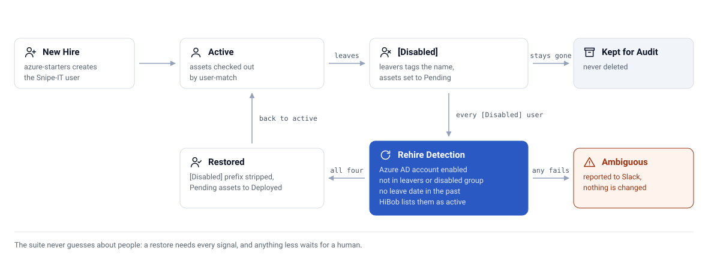

# How it works

The suite is one Python program with one command per job (`python src/main.py <command>`). In production, five EventBridge rules start the same ECS Fargate task, and the command each rule passes decides which jobs run. Locally, the same commands run from a terminal, or on a timer through the container scheduler.

<picture>
  <source media="(prefers-color-scheme: dark)" srcset="assets/architecture-dark.svg">
  
</picture>

## Which system decides what

| System | Role | Written to? |
|--------|------|-------------|
| Jamf Pro | Device management: serials, local accounts, hardware models | Yes (an extension attribute, wake commands) |
| Snipe-IT | Asset register: owners, checkout state, accessories | Yes (the main target) |
| Azure AD / Entra ID | Identity: account status, group membership, job titles | No |
| HiBob | HR source of truth: employment status, equipment entitlements | No, never |

## The user lifecycle

<picture>
  <source media="(prefers-color-scheme: dark)" srcset="assets/lifecycle-dark.svg">
  
</picture>

A new starter in the starters group in Azure AD gets a Snipe-IT user (`azure-starters`). When someone leaves, `leavers` tags the user `[Disabled]` and moves their assets to *Pending*. Nothing is deleted.

### Rehires need four signals

A `[Disabled]` user comes back automatically only when all four of these hold:

1. The Azure AD account is enabled.
2. The person is in neither the leavers group nor the disabled group.
3. No leave date has passed.
4. HiBob lists them as an active employee (read-only).

Anything less is classed as ambiguous and posted to Slack for a person to decide. The suite does not guess about someone's employment.

`rehire-detection` runs before every other lifecycle and sync job so a returner is restored before the sync chain looks for their machine.

## How a Mac finds its owner

`user-match` reads the local accounts on each Jamf machine and tries these in order, stopping at the first that fits:

1. A manual override from `config/user_overrides.json`.
2. An exact match.
3. An email match.
4. A normalised username match.
5. A fuzzy name score.
6. The optional external AI service, for cases the scoring cannot settle.

A device is only reassigned automatically when the match reason is an exact one. The AI step is off unless `AI_API_KEY` is set, and its payloads are tokenised by default (`modules.ai_audit.allow_external_pii` opts in to raw identifiers).

## Schedule

The container scheduler runs in `Europe/London`, one job per slot, all under the run mutex. In AWS the EventBridge rules set the timing instead (`terraform/`); see the runbook.

| Day | Time | Job | Purpose |
|-----|------|-----|---------|
| Mon | 17:00 | `azure_starters` | Provision the week's new starters |
| Mon | 18:00 | `user_enrichment` | Titles, departments, contractor markers |
| Mon | 18:10 | `peripherals_sync` | HiBob equipment to accessories |
| Mon, Thu | 19:00 | `health_check` | Drift and stuck-state scan |
| Tue | 17:30 | `rehire_detection` | Restore returners before the sync chain |
| Tue | 18:00 | `correction` | Fix wrong assignments |
| Tue | 18:30 | `user_match` | Match machines and check them out |
| Tue | 19:00 | `snipe_to_jamf` | Push asset IDs to Jamf |
| Tue | 19:30 | `leavers` | Process departures last |
| Sun | 22:00 to 23:00 | housekeeping | `model_sync`, `cleanup`, `username_standardize`, `ai_audit`, `reconciliation` |

The 30-minute slots keep a slow job from running into the next one. If one does, the mutex skips the later job instead of interleaving the two.

## Safety guards

| Guard | Protects against |
|-------|------------------|
| Fail-closed run mutex in SSM on every job | Overlapping or unlocked runs undoing each other |
| Dry-run latch on `rehire-detection` and `cleanup` | A new or destructive module going live before you have read its output |
| Tokenised AI-audit payloads by default | Employee and device identifiers leaving your systems |
| Four-signal rehire check including HiBob | Restoring someone who is actually leaving |
| Slack queue for ambiguous cases | Automated guesses about people |
| Fetch-integrity aborts | An empty API response triggering mass duplicate creation |
| Assets go to *Pending*, never deleted | Any destructive action on leaver data |
| HiBob read-only | Any write reaching the HR system |
| Read-only root filesystem in the container | Code or dependencies changing at runtime |
| Task-failure and launch-failure alerts to SNS | A scheduled run failing silently |

## Configuration layers

| Source | Used by | Notes |
|--------|---------|-------|
| `config/config.yaml` | Local CLI and `docker compose` | Gitignored, never committed |
| Task-definition environment variables | AWS Fargate | Non-secret settings: group IDs, matching rules |
| SSM Parameter Store | AWS Fargate | Secrets under `/jamf-snipeit-suite-prod/*`, read at container start |

Environment variables win over the file. Fargate never reads `config.yaml`, so a config change there means a new task-definition revision with all five rules repointed to it.

Per-module controls: `modules.<name>.enabled` skips a module everywhere (CLI, `run-group`, `all`, scheduler). `modules.<name>.dry_run` forces dry run and callers cannot force it back to live. Env-only deployments use `MODULE_<NAME>_ENABLED` and `MODULE_<NAME>_DRY_RUN`, for example `MODULE_USER_MATCH_DRY_RUN=true`; Terraform exposes the same through `module_enabled_overrides` and `module_dry_run_overrides`.

| Setting | Purpose |
|---------|---------|
| `azure.starters_group_id` | Azure AD group of active staff to provision |
| `azure.leavers_group_id`, `azure.disabled_group_id` | Leaver signals |
| `modules.rehire_detection.hibob_confirmation` | Require HiBob to confirm rehires |
| `modules.user_enrichment.mark_contractors` | Keep the `Contractor` department as a Snipe-IT marker |
| `modules.ai_audit.allow_external_pii` | Allow raw identifiers in AI prompts (default off) |
| `modules.health_check.max_workers` | Concurrency for the Jamf health index (default 8) |
| `matching.skip_usernames` | Shared or test local accounts to ignore |
| `config/user_overrides.json` | Manual match overrides; local only, gitignored |

See [`config/config.example.yaml`](../config/config.example.yaml) for every key.
