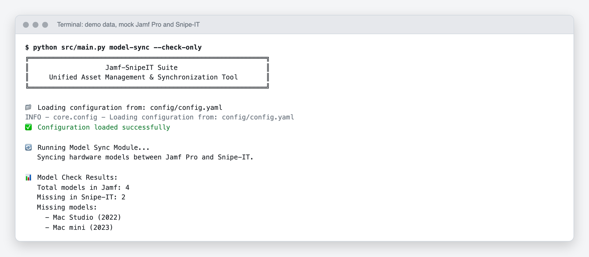
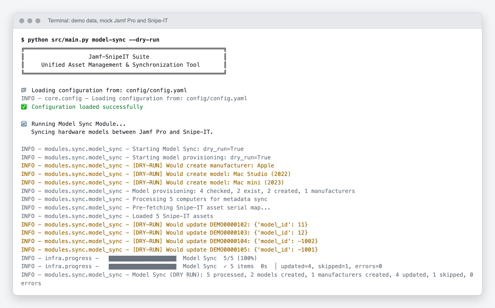

# Setup

This walks from a clone to a first safe run on your laptop, then to AWS. The first run changes nothing: it asks Jamf Pro and Snipe-IT which hardware models are missing.

You need Python 3.12 or newer (or Docker), a Jamf Pro account that can read computers, and a Snipe-IT API token. Azure AD, HiBob and Slack credentials are needed only by the modules that use them.

## 1. Get the code

```bash
git clone https://github.com/CaputoDavide93/Jamf-SnipeIT-Suite.git
cd Jamf-SnipeIT-Suite
python3 -m venv venv && source venv/bin/activate
pip install -r requirements.txt
```

## 2. Add your credentials

```bash
cp config/config.example.yaml config/config.yaml
```

Open `config/config.yaml` and fill in the `jamf` and `snipeit` sections first. Jamf Pro takes a username and password, or an OAuth client ID and secret. The file is gitignored. Do not commit it.

## 3. Run the read-only check

```bash
python src/main.py model-sync --check-only
```

It prints the models Jamf knows that Snipe-IT does not, and changes nothing. With the demo data used for these screenshots it looks like this:

<picture>
  <source media="(prefers-color-scheme: dark)" srcset="assets/screenshots/model-sync-check-dark.png">
  
</picture>

## 4. Preview a real change

```bash
python src/main.py model-sync --dry-run
```

`--dry-run` (or `-n`) works on every command that changes data. Each line starting `[DRY-RUN]` is something it would do.

<picture>
  <source media="(prefers-color-scheme: dark)" srcset="assets/screenshots/model-sync-dry-run-dark.png">
  
</picture>

Run the same command without `--dry-run` when the preview looks right. Before you enable the rest, read [How it works](how-it-works.md): `rehire-detection` and `cleanup` start as dry runs on purpose.

`python src/main.py` with no command opens an interactive menu of every module.

## 5. Run on a schedule in Docker

```bash
docker compose up
```

This starts the scheduler with a `/healthz` liveness endpoint on port 8080. `./config` is mounted read-only, so `config/config.yaml` must exist first. One-off runs use the `cli` profile, for example `docker compose run --rm cli leavers --dry-run`.

## 6. Deploy to AWS Fargate

Production runs as five EventBridge rules that start one Fargate task. The infrastructure is in `terraform/`.

1. Copy `terraform/environments/prod/terraform.tfvars.example` to `terraform.tfvars` and `backend.hcl.example` to `backend.hcl`, then fill them in. Both real files are gitignored.
2. Run `./scripts/deploy.sh`. It runs the Terraform plan and apply, then builds and pushes `:latest` and a `:base` tag to ECR.
3. Set `alerts_topic_arn` or `alarm_email` so a failed run reaches you.

Build the image for `linux/amd64`. An ARM64 image fails on Fargate without a clear error. Day-to-day tasks (rotating secrets, overrides, on-demand runs, rollback) are in [operations.md](operations.md).

## Run the checks

```bash
make venv     # once
make check    # ruff, pytest, generated docs and icon, all up to date
```

`make screenshots` retakes the pictures above against a local mock of Jamf Pro and Snipe-IT. It needs Chromium (installed by the target).
